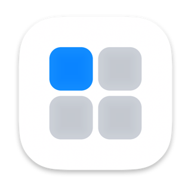
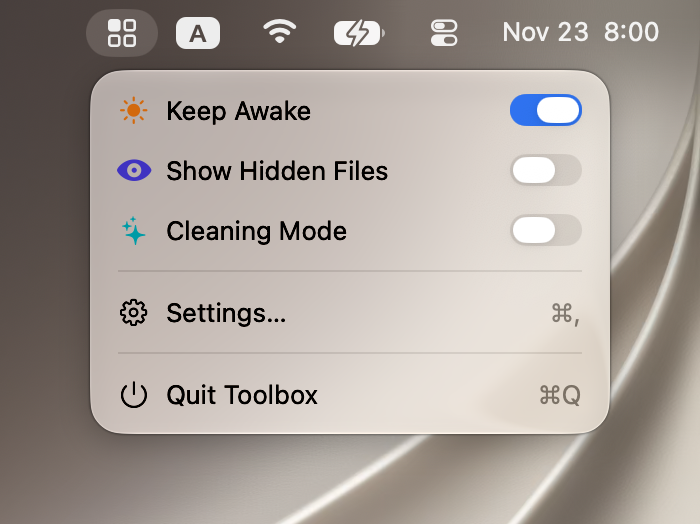
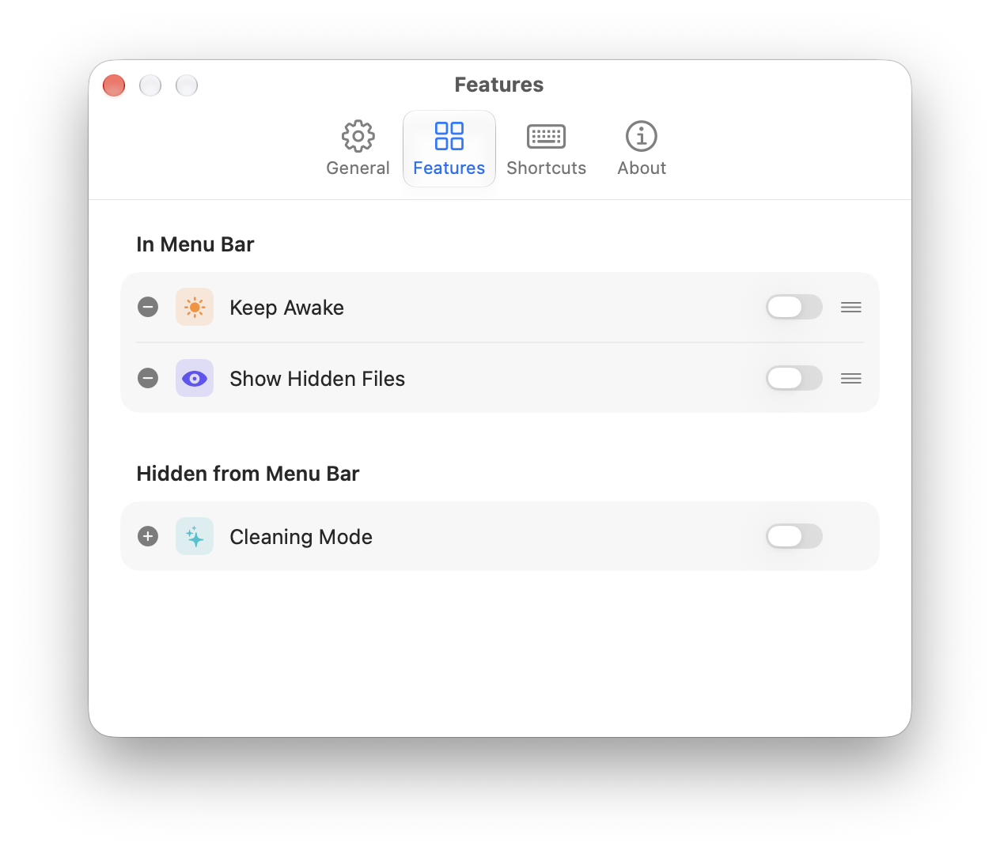

<p align="center">
  
</p>

# Toolbox

[English](README.md) | [简体中文](README.zh-CN.md)

A menu bar toolbox for macOS.

<p align="center">
  
</p>

## Features

- **Keep Awake**: prevents your Mac from sleeping automatically.
- **Show Hidden Files**: shows hidden files in Finder.
- **Cleaning Mode**: locks the screen and keyboard so you can clean your Mac. Click Exit to unlock.

Also:

- Keyboard shortcuts for each feature, set in **Settings → Shortcuts**
- Choose which features appear in the menu bar and drag to reorder them, in **Settings → Features**

<p align="center">
  
</p>

## Install

Requires macOS 14 or later. Supports Apple silicon and Intel processors.

Download the DMG from [Releases](https://github.com/itzLan1126/Toolbox/releases/latest) and drag Toolbox to Applications.

> [!IMPORTANT]
> Toolbox isn't notarized by Apple, so macOS blocks it the first time you open it. To fix this, run in Terminal:
>
> ```sh
> xattr -dr com.apple.quarantine /Applications/Toolbox.app
> ```

## FAQ

### Why does it ask for Accessibility permission?

Only Cleaning Mode needs it, to lock the screen and keyboard. Toolbox asks only when you first turn on Cleaning Mode. Other features need no permissions.

### Do I have to grant Accessibility again after an update?

No. Every release is signed with the same certificate, so macOS keeps the permission.

### Does Keep Awake work when I close my MacBook?

No. It only stops your Mac from sleeping on its own; closing your MacBook still puts it to sleep. Quitting Toolbox also turns it off.

### How do I uninstall?

First turn off Show Hidden Files (otherwise Finder keeps showing hidden files) and Launch at Login. Then quit Toolbox and move it to the Trash.

## Development

Requires Xcode 26 (Swift 6.2).

```sh
brew install xcodegen
xcodegen generate
open Toolbox.xcodeproj
```

Run the tests with ⌘U in Xcode, or from the command line:

```sh
xcodebuild -project Toolbox.xcodeproj -scheme Toolbox test
```

## Acknowledgements

- [KeyboardShortcuts](https://github.com/sindresorhus/KeyboardShortcuts) by Sindre Sorhus
- [Sparkle](https://github.com/sparkle-project/Sparkle) by the Sparkle Project

## License

[GPL-3.0](LICENSE)
