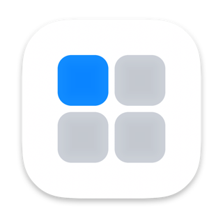
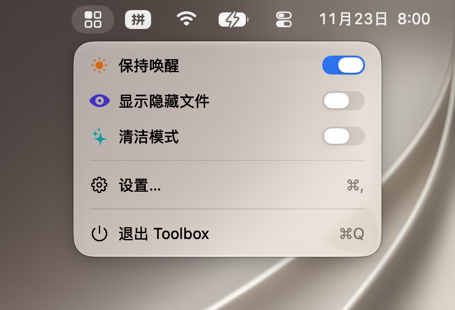
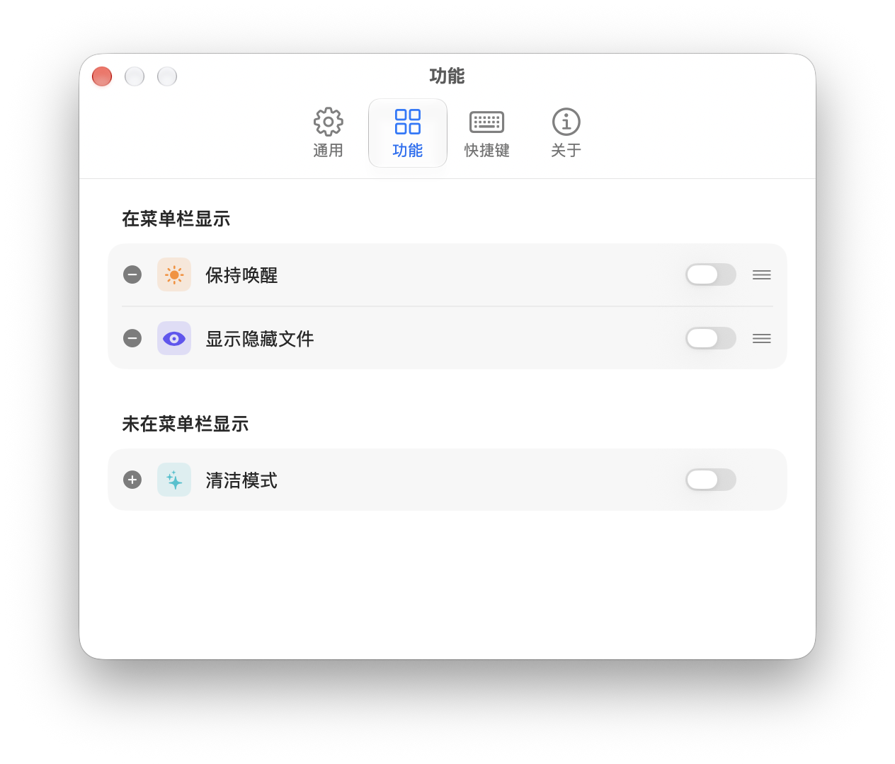

<p align="center">
  
</p>

# Toolbox

[English](README.md) | [简体中文](README.zh-CN.md)

一款 macOS 菜单栏工具箱。

<p align="center">
  
</p>

## 功能

- **保持唤醒**：防止 Mac 自动进入睡眠。
- **显示隐藏文件**：在 Finder 中显示隐藏文件。
- **清洁模式**：锁定屏幕和键盘，方便清洁 Mac，点击“退出”即可解除。

另外还支持：

- 为每个功能设置快捷键（**设置 → 快捷键**）
- 选择哪些功能显示在菜单栏，并拖动调整顺序（**设置 → 功能**）

<p align="center">
  
</p>

## 安装

需要 macOS 14 或更高版本，支持 Apple 芯片和 Intel 处理器。

从 [Releases](https://github.com/itzLan1126/Toolbox/releases/latest) 下载 DMG，把 Toolbox 拖进“应用程序”文件夹。

> [!IMPORTANT]
> Toolbox 未经 Apple 公证，第一次打开时会被 macOS 拦截。在“终端”中运行下面的命令即可解决：
>
> ```sh
> xattr -dr com.apple.quarantine /Applications/Toolbox.app
> ```

## 常见问题

### 为什么需要“辅助功能”权限？

只有清洁模式需要，用来锁定屏幕和键盘。Toolbox 只会在你第一次开启清洁模式时请求。其他功能不需要任何权限。

### 更新后需要重新授予“辅助功能”权限吗？

不需要。每个版本都用同一张证书签名，macOS 会保留授权。

### 合上 MacBook 后，保持唤醒还有效吗？

无效。它只阻止 Mac 自动进入睡眠，合上 MacBook 后它仍会睡眠。退出 Toolbox 也会关闭保持唤醒。

### 如何卸载？

先关闭“显示隐藏文件”（否则 Finder 会一直显示隐藏文件）和“登录时启动”，然后退出 Toolbox，把它移到废纸篓。

## 开发

需要 Xcode 26（Swift 6.2）。

```sh
brew install xcodegen
xcodegen generate
open Toolbox.xcodeproj
```

在 Xcode 中按 ⌘U 运行测试，或在命令行运行：

```sh
xcodebuild -project Toolbox.xcodeproj -scheme Toolbox test
```

## 致谢

- [KeyboardShortcuts](https://github.com/sindresorhus/KeyboardShortcuts)，作者 Sindre Sorhus
- [Sparkle](https://github.com/sparkle-project/Sparkle)，作者 Sparkle Project

## 许可证

[GPL-3.0](LICENSE)
